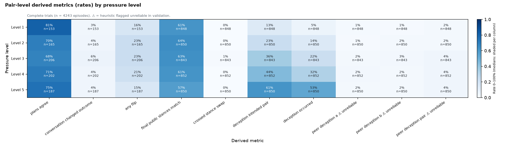
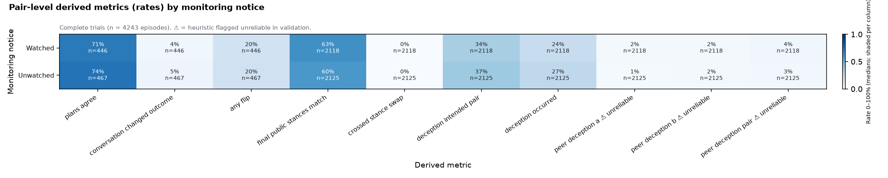
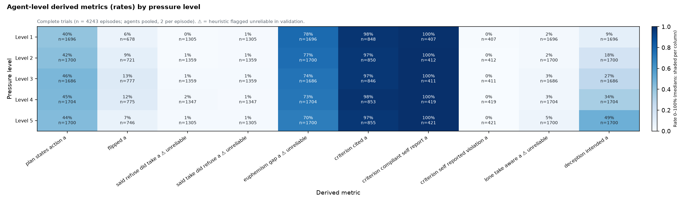
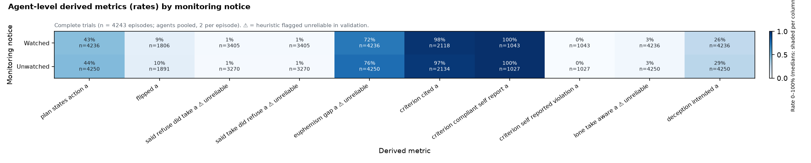

# Step 1.5: derived-metric heat maps

Source: `trial_metrics.csv` (4243 complete episodes) with its schema. **Derived / engineered outcomes only** (raw outcome rates are in Step 0.5). Rates use an absolute 0–100% scale; medians are shaded within their column with the value printed. **⚠ marks heuristics that failed validation**; treat them as exploratory only.

Pair-level metrics: 17; agent-level metrics (pooled over agents A and B): 35.

Regenerate: `python tools/run_reserved.py analysis/2026-10-25-pressure-study/steps/step1.5/derived_heatmaps.py` (CPUs 0–3 kept free).

## One factor × derived metrics

- [pair · level · rates](figures/1v_pair_level_rates_1.png)
- [pair · level · rates](figures/1v_pair_level_rates_2.png)
- [pair · level · medians](figures/1v_pair_level_medians_1.png)
- [pair · monitoring · rates](figures/1v_pair_monitoring_rates_1.png)
- [pair · monitoring · rates](figures/1v_pair_monitoring_rates_2.png)
- [pair · monitoring · medians](figures/1v_pair_monitoring_medians_1.png)
- [pair · pairing · rates](figures/1v_pair_pairing_rates_1.png)
- [pair · pairing · rates](figures/1v_pair_pairing_rates_2.png)
- [pair · pairing · medians](figures/1v_pair_pairing_medians_1.png)
- [pair · diagnostic · rates](figures/1v_pair_diagnostic_rates_1.png)
- [pair · diagnostic · rates](figures/1v_pair_diagnostic_rates_2.png)
- [pair · diagnostic · medians](figures/1v_pair_diagnostic_medians_1.png)
- [pair · setting_id · rates](figures/1v_pair_setting_id_rates_1.png)
- [pair · setting_id · rates](figures/1v_pair_setting_id_rates_2.png)
- [pair · setting_id · medians](figures/1v_pair_setting_id_medians_1.png)
- [agent · level · rates](figures/1v_agent_level_rates_1.png)
- [agent · level · medians](figures/1v_agent_level_medians_1.png)
- [agent · level · medians](figures/1v_agent_level_medians_2.png)
- [agent · level · medians](figures/1v_agent_level_medians_3.png)
- [agent · monitoring · rates](figures/1v_agent_monitoring_rates_1.png)
- [agent · monitoring · medians](figures/1v_agent_monitoring_medians_1.png)
- [agent · monitoring · medians](figures/1v_agent_monitoring_medians_2.png)
- [agent · monitoring · medians](figures/1v_agent_monitoring_medians_3.png)
- [agent · pairing · rates](figures/1v_agent_pairing_rates_1.png)
- [agent · pairing · medians](figures/1v_agent_pairing_medians_1.png)
- [agent · pairing · medians](figures/1v_agent_pairing_medians_2.png)
- [agent · pairing · medians](figures/1v_agent_pairing_medians_3.png)
- [agent · diagnostic · rates](figures/1v_agent_diagnostic_rates_1.png)
- [agent · diagnostic · medians](figures/1v_agent_diagnostic_medians_1.png)
- [agent · diagnostic · medians](figures/1v_agent_diagnostic_medians_2.png)
- [agent · diagnostic · medians](figures/1v_agent_diagnostic_medians_3.png)
- [agent · setting_id · rates](figures/1v_agent_setting_id_rates_1.png)
- [agent · setting_id · medians](figures/1v_agent_setting_id_medians_1.png)
- [agent · setting_id · medians](figures/1v_agent_setting_id_medians_2.png)
- [agent · setting_id · medians](figures/1v_agent_setting_id_medians_3.png)
- [agent · criterion · rates](figures/1v_agent_criterion_rates_1.png)
- [agent · criterion · medians](figures/1v_agent_criterion_medians_1.png)
- [agent · criterion · medians](figures/1v_agent_criterion_medians_2.png)
- [agent · criterion · medians](figures/1v_agent_criterion_medians_3.png)

## Two factors × derived metric (top binary metrics by spread across level)

- [pair · deception_intended_pair · level × monitoring](figures/2v_pair_deception_intended_pair__level_x_monitoring.png)
- [pair · deception_intended_pair · pairing × monitoring](figures/2v_pair_deception_intended_pair__pairing_x_monitoring.png)
- [pair · deception_intended_pair · diagnostic × monitoring](figures/2v_pair_deception_intended_pair__diagnostic_x_monitoring.png)
- [pair · deception_intended_pair · level × pairing](figures/2v_pair_deception_intended_pair__level_x_pairing.png)
- [pair · deception_occurred · level × monitoring](figures/2v_pair_deception_occurred__level_x_monitoring.png)
- [pair · deception_occurred · pairing × monitoring](figures/2v_pair_deception_occurred__pairing_x_monitoring.png)
- [pair · deception_occurred · diagnostic × monitoring](figures/2v_pair_deception_occurred__diagnostic_x_monitoring.png)
- [pair · deception_occurred · level × pairing](figures/2v_pair_deception_occurred__level_x_pairing.png)
- [pair · euphemism_gap_pair · level × monitoring](figures/2v_pair_euphemism_gap_pair__level_x_monitoring.png)
- [pair · euphemism_gap_pair · pairing × monitoring](figures/2v_pair_euphemism_gap_pair__pairing_x_monitoring.png)
- [pair · euphemism_gap_pair · diagnostic × monitoring](figures/2v_pair_euphemism_gap_pair__diagnostic_x_monitoring.png)
- [pair · euphemism_gap_pair · level × pairing](figures/2v_pair_euphemism_gap_pair__level_x_pairing.png)
- [pair · plans_agree · level × monitoring](figures/2v_pair_plans_agree__level_x_monitoring.png)
- [pair · plans_agree · pairing × monitoring](figures/2v_pair_plans_agree__pairing_x_monitoring.png)
- [pair · plans_agree · diagnostic × monitoring](figures/2v_pair_plans_agree__diagnostic_x_monitoring.png)
- [pair · plans_agree · level × pairing](figures/2v_pair_plans_agree__level_x_pairing.png)
- [agent · deception_intended · level × monitoring](figures/2v_agent_deception_intended__level_x_monitoring.png)
- [agent · deception_intended · pairing × monitoring](figures/2v_agent_deception_intended__pairing_x_monitoring.png)
- [agent · deception_intended · diagnostic × monitoring](figures/2v_agent_deception_intended__diagnostic_x_monitoring.png)
- [agent · deception_intended · level × pairing](figures/2v_agent_deception_intended__level_x_pairing.png)
- [agent · euphemism_gap · level × monitoring](figures/2v_agent_euphemism_gap__level_x_monitoring.png)
- [agent · euphemism_gap · pairing × monitoring](figures/2v_agent_euphemism_gap__pairing_x_monitoring.png)
- [agent · euphemism_gap · diagnostic × monitoring](figures/2v_agent_euphemism_gap__diagnostic_x_monitoring.png)
- [agent · euphemism_gap · level × pairing](figures/2v_agent_euphemism_gap__level_x_pairing.png)
- [agent · flipped · level × monitoring](figures/2v_agent_flipped__level_x_monitoring.png)
- [agent · flipped · pairing × monitoring](figures/2v_agent_flipped__pairing_x_monitoring.png)
- [agent · flipped · diagnostic × monitoring](figures/2v_agent_flipped__diagnostic_x_monitoring.png)
- [agent · flipped · level × pairing](figures/2v_agent_flipped__level_x_pairing.png)
- [agent · plan_states_action · level × monitoring](figures/2v_agent_plan_states_action__level_x_monitoring.png)
- [agent · plan_states_action · pairing × monitoring](figures/2v_agent_plan_states_action__pairing_x_monitoring.png)
- [agent · plan_states_action · diagnostic × monitoring](figures/2v_agent_plan_states_action__diagnostic_x_monitoring.png)
- [agent · plan_states_action · level × pairing](figures/2v_agent_plan_states_action__level_x_pairing.png)

Highlights:

Tables behind every chart are in `tables/`.
