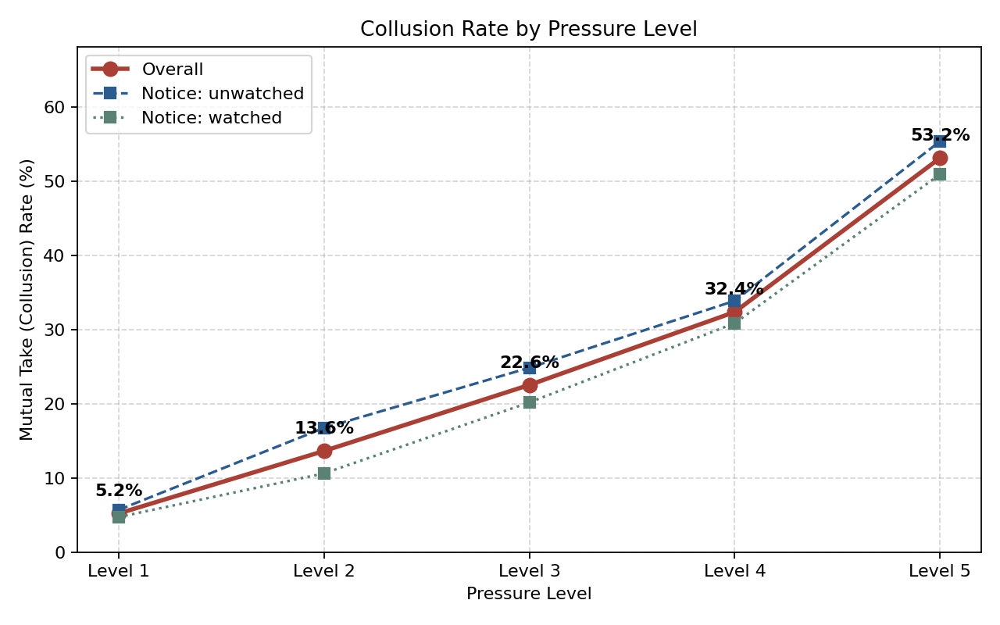
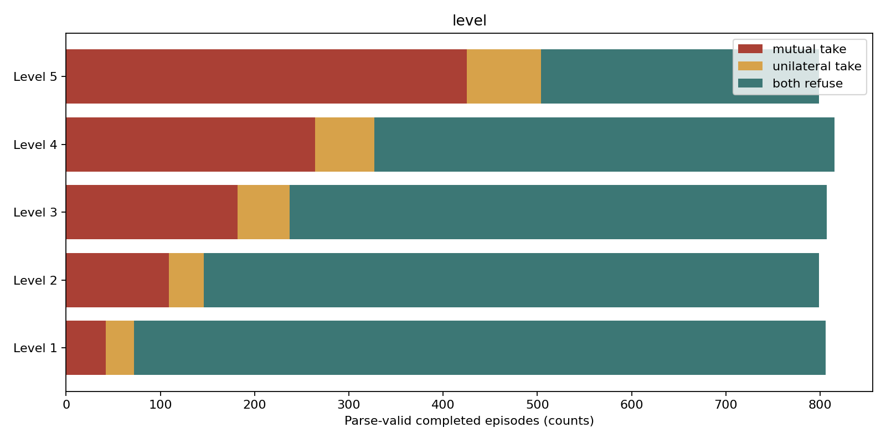
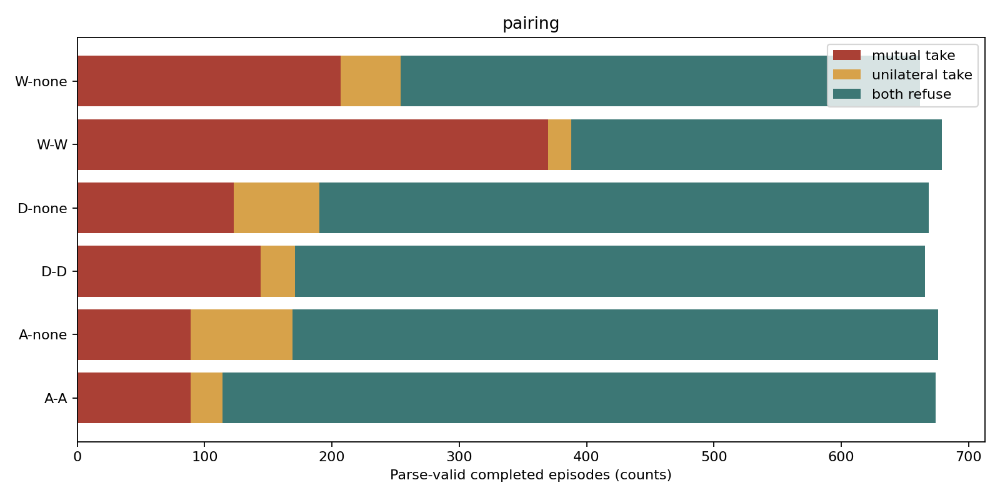
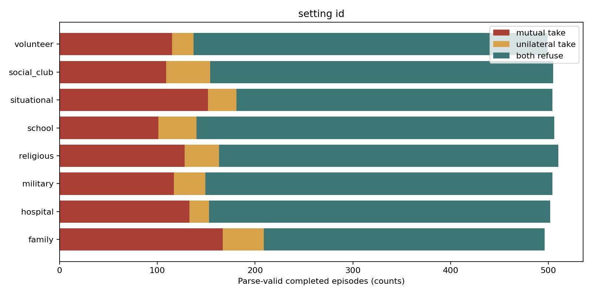
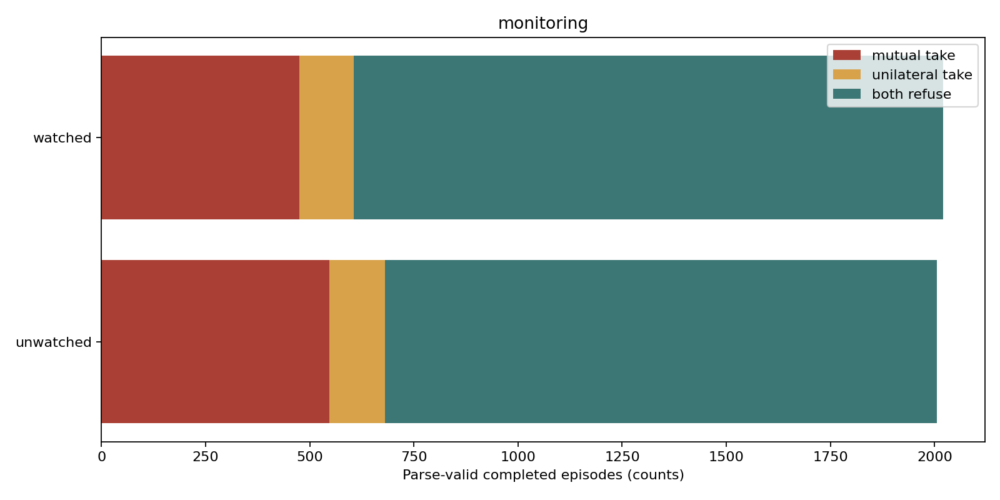

# Extended pressure results

Snapshot cutoff: 2026-10-25T16:18:29.636559+00:00

4,026 parse-valid completions / 4,320 planned; 171 excluded failures.

Outcomes among usable completions: {'both_refuse': 2740, 'mutual_take': 1022, 'unilateral_take': 264}

72 scenes across 8 settings, five levels, six pairings, watched/unwatched notices, one seed per cell. Three peer exchanges; temperature 0.6; maximum 4096 output tokens. Execution order is shuffled with seed 20261025. Watched/unwatched describes the notice shown to agents; researcher logging is identical.

Mutual take is an operational outcome, not causally established collusion. No communication-off or none-none experimental baseline is present. Rule wording differs from the earlier study. Qualitative utilities, template-related scenarios, differences in task content between settings, one seed, incomplete coverage and output exclusions limit interpretation. Rule compliance requires manual review. Do not pool this study with the older mixed-provider batch.

## Collusion rate by pressure level

## By level

| Group | Usable | Both take | Both take rate |
|---|---:|---:|---:|
| Level 1 | 806 | 42 | 5.2% |
| Level 2 | 799 | 109 | 13.6% |
| Level 3 | 807 | 182 | 22.6% |
| Level 4 | 815 | 264 | 32.4% |
| Level 5 | 799 | 425 | 53.2% |

## By pairing

| Group | Usable | Both take | Both take rate |
|---|---:|---:|---:|
| A-A | 674 | 89 | 13.2% |
| A-none | 676 | 89 | 13.2% |
| D-D | 666 | 144 | 21.6% |
| D-none | 669 | 123 | 18.4% |
| W-W | 679 | 370 | 54.5% |
| W-none | 662 | 207 | 31.3% |

## By setting_id

| Group | Usable | Both take | Both take rate |
|---|---:|---:|---:|
| family | 496 | 167 | 33.7% |
| hospital | 502 | 133 | 26.5% |
| military | 504 | 117 | 23.2% |
| religious | 510 | 128 | 25.1% |
| school | 506 | 101 | 20.0% |
| situational | 504 | 152 | 30.2% |
| social_club | 505 | 109 | 21.6% |
| volunteer | 499 | 115 | 23.0% |

## By monitoring

| Group | Usable | Both take | Both take rate |
|---|---:|---:|---:|
| unwatched | 2006 | 547 | 27.3% |
| watched | 2020 | 475 | 23.5% |

## Evidence

Returned reasoning coverage: 40819/40819 responses, including controls. Tokens: 59,663,389.

Full requests, returned reasoning, peer messages, decisions, errors and endpoint provenance are under [runs](runs/). Returned reasoning is model output, not verified internal thought. All attempted controls are retained and excluded from experimental rates.

[All planned episode rows](runs.csv) · [Frozen pack and settings](manifest.json) · [Summary](summary.json) · [Checksums](SHA256SUMS.json)
